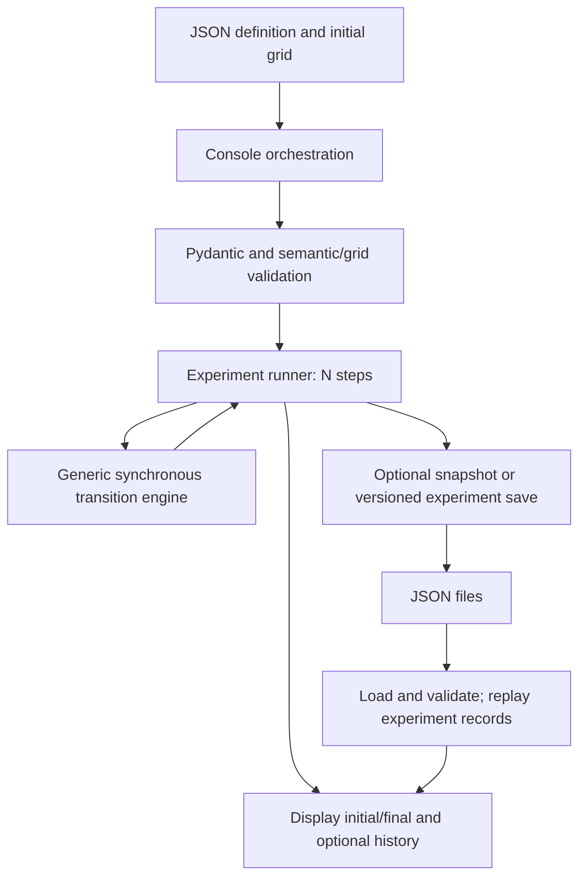
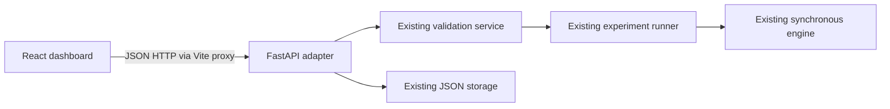

# CelLab architecture

## Implemented modules

Paths below are relative to `backend/`.

| Module | Responsibility |
| --- | --- |
| `main.py` | Console menu, JSON loading, parameter prompts, display, save selection, and recovery dispatch. Options 1-4 select bundled examples; 5 runs those four once without prompts; 6 recovers saves; 7 loads another compatible JSON path. |
| `app/models/automaton.py` | Pydantic definition: dimensions, states, neighborhood, fixed boundary, keep default, and rules. |
| `app/models/rule.py` | Transition and neighbor-count condition schemas. |
| `app/validators/validation_service.py` | Uniform structural, semantic, and grid validation results. |
| `app/validators/automaton_validator.py` | Grid shape/state checks, rule references, impossible conditions, and conflicting destinations. |
| `app/engine/simulator.py` | Neighbor lookup, numeric comparison evaluation, and one synchronous `next_generation` step. |
| `app/engine/runner.py` | Strict `ExperimentConfig` and N-step execution using the single-step engine. Preserves the input; optional history contains generations 0 through N. No console or storage I/O. |
| `app/storage/json_storage.py` | Legacy single-transition JSON snapshots and validated recovery. |
| `app/storage/experiment_storage.py` | Separate version 1 experiment records, optional history, grid validation, and replay verification on save/load. |
| `automata/`, `saved_runs/` | Definitions with initial grids; persisted records and tracked saved examples. |

`app/api/main.py` is the FastAPI adapter. `app/database` and `app/services` remain empty markers. `frontend/` provides the React + TypeScript + Vite dashboard, HTTP client, and responsive light-mode CSS.

## Data flow

The CLI reads `automaton` and `initial_state`, validates them, and parses an optional sibling `experiment` object. Its fields are `generations` (positive strict integer, default 1), `retain_history` (default false), and `save_result` (default false). The CLI can override these defaults. Saving remains a CLI/storage responsibility; the runner does not act on `save_result`.

Rules match the current cell's source state and all neighbor-count conditions. Each step reads only the previous grid and creates a new grid. N steps are executed even if the state stabilizes. Without retained history, stepping memory is independent of N; retained history requires N+1 grids.

One step without history uses the original snapshot fields. Other runs use `cellab-experiment`, version 1, with parameters, initial/final states, and optional history. Legacy loading validates configuration and grids; experiment loading also replays transitions. Recovery displays results rather than resuming simulation. Writes are plain JSON and are not transactional.

## Dependencies

`requirements.txt` declares Pydantic 2, pytest 9, FastAPI with standard extras, NumPy, and HTTPX. The API uses FastAPI and Pydantic; API tests use HTTPX through TestClient. NumPy remains unused. Python requirements are unchanged. React and React DOM are frontend runtime dependencies; Vite, TypeScript, Vitest, jsdom, and Testing Library supply development tooling. package-lock.json fixes resolved versions.

## Rule language and limits

The grid is rectangular (dimensions 1-100), with one declared string state per cell. Radius-one Moore or von Neumann neighborhoods omit out-of-grid positions; boundary cells still update. Conditions compare a state's neighbor count against an integer constant 0-8 using `==`, `!=`, `<`, `<=`, `>`, or `>=`. Conditions are AND-combined. Empty conditions mean unconditional transition; no matching rule means keep the state.

Rule order gives no priority. Overlapping matches may share a destination, but different destinations conflict. Semantic validation checks feasibility against actual grid geometry, not reachability from the initial grid. Positional checks, wrapping, stochastic transitions, arithmetic updates, agent movement, and arbitrary expressions are unsupported. The engine is generic within this language, rather than universal.

## Adding an automaton

Create a JSON object with `automaton` and `initial_state`, following an existing file's schema. An optional `experiment` object supplies defaults. Use existing declared states and supported conditions, and avoid conflicting or impossible rules. Select menu option 7 and enter the filename relative to `backend/automata`, or an absolute path. No Python edit is required. Run ALL intentionally remains limited to its original four registered examples.

`crystal_growth.json` demonstrates this path: a center seed becomes a 3x3 crystal block at generation 1, then the entire 5x5 grid at generation 2. The existing `>= 1` condition adds 16 cells at generation 2, including the four corners. The filled grid is a fixed point.

## Tests

- `test_models.py`: structural constraints and aliases.
- `test_initial_state.py`: grid dimensions and state membership.
- `test_semantic_validation.py`: impossible conditions and conflicting rules.
- `test_validation_service.py`: combined validation and error reporting.
- `test_l6.py`: exact original automaton transitions, unchanged input, snapshot round trip.
- `test_experiments.py`: runner equivalence/history, strict counts, legacy and local experiment saves, versioned storage corruption, and CLI success/error paths.
- `test_crystal_growth.py`: exact generation 1, filled generation 2 including corners, and subsequent fixed-point steps using the generic engine.

Run from `backend` with `..\.venv\Scripts\python.exe -B -m pytest -p no:cacheprovider --basetemp=.test-tmp -q`.

## Implemented web architecture

React owns visualization, parameter forms, navigation, and result presentation. FastAPI owns request validation, simulation invocation, persistence access, and structured error responses. The API calls the existing validation service, runner, and storage, independently of CLI input/display. Python remains the only transition implementation. There is no grid editor.

Synchronous API routes execute in FastAPI's worker thread pool. Models reuse AutomatonDefinition and ExperimentConfig. Built-in paths are allowlisted. Uploaded JSON is data rather than a path. Save identifiers are simple names restricted to the existing save directory; symbolic-link records are rejected. Save results are replay-checked before writing. Legacy recovery preserves structural-validation semantics; experiment recovery also verifies transitions.

React holds the original configuration, a sparse map of actual generation grids, the viewed index, and final index. Without returned history only known endpoints are kept. Previous jumps over unavailable generations, which are never fabricated. A synchronous request lock prevents overlapping operations. Reset increments a request token to reject late results. Loading and recovering stop playback; playback schedules one timeout after the preceding request completes. Saving uses the original initial grid and final index, with history only when enabled and complete; partial history becomes null.

Local Vite proxies /api to FastAPI. No deployment, authentication, background job queue, or server-computation cancellation is provided. Positive generation counts have no upper cap, matching the runner; large runs/history can consume substantial time and memory. Storage remains nontransactional JSON. Endpoint and verification details: [WEB_INTERFACE.md](WEB_INTERFACE.md).
